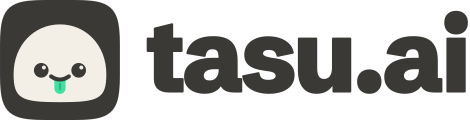

# tasu.ai brand kit

Tasu is a cream mochi with a mint tongue. tasu.ai means "taste using AI", and taste lives on the tongue. So the tongue is the only mint in the mark.

## The pick

3 logo concepts, each scored from 1 to 10 on its own board, as submitted.

| Criterion | A. The taster | B. Scoop, the spoon | C. The tarsier |
|---|---|---|---|
| Memorable | 7 | 6 | 8 |
| Charm, Appllama level | 7 | 6 | 8 |
| Readable at 16 px | 9 | 7 | 5 |
| Original (no llama, no UFO) | 7 | 6 | 5 |
| 3-color discipline | 10 | 7 | 6 |
| Works as a hero scene | 5 | 7 | 8 |
| Fits "taste" for app builders | 10 | 8 | 6 |
| **Total, out of 70** | **55** | **47** | **46** |

**Winner: A, the taster.** It scores 55 of 70.

- **A, the taster.** The tongue is taste in one shape, and it is the only mint. At 16 px, the pixel-snapped favicon keeps 2 dark eyes and a mint tongue. Its weak point was the hero: the paws read as a second pair of eyes, and the card hid the smile.
- **B, Scoop.** The spoon shape holds at 16 px, but it also reads as a key or a magnifier. Its hero has the clearest action, but it puts mint in 4 places: tongue, plan outline, plan dot and main button. A spoon also points to food more than to apps.
- **C, the tarsier.** It has the most charm and the best scene: chin on the paywall, tail curled. At 16 px the face turns to noise, and the mint eye rings take far more than 10% of the icon. A cute animal peeking is also the closest genre to Appllama's llama.

**One graft, from the runner-up Scoop:** Tasu shuts its eyes in delight while it tastes. It appears in hero.svg only. The icon keeps the open eyes, which read better at small sizes.

What the polish changed:

- **Hero, redrawn.** Tasu peeks over a floating paywall card with its whole face in view. The tongue drapes over the card's top edge, and its tip cuts the picked row's stroke cleanly. The paws are gone. The selection mark sits at the right end of the picked plan, iOS style, apart from the tongue. It reads at 160 px on both themes.
- **Icon.** The eye shine shrank from 30% to 27% of the eye radius, so the eyes stay dark at 32 px.
- **Mouth, redrawn.** The tongue grows out of the smile's lowest point, centred. Smile and tongue read as one shape from 16 px to 512 px. See "The mouth" below.
- **Lockup.** The wordmark uses `currentColor`. Its x-height sits on the tile's centre line, 5 units low on a 120-unit tile, so the round letters look centred.
- **New:** apple-touch-icon.png in line style on cream, and og.png.

## Files

| File | What it is | Use it for |
|---|---|---|
| `icon.svg` | 512 grid. Grey tile, cream mochi, flat. | App icon, avatar, header icon. 24 px and up. Both themes. |
| `favicon.svg` | Drawn for 16 px: no eye shine, eyes on whole pixel rows, a 1 px dark smile over a 2 px mint tongue. | Browser tab, 16 to 32 px. Both themes. |
| `lockup.svg` | Icon + "tasu.ai" wordmark, grey. 470.3 x 120 viewBox. | Light theme, on cream. |
| `lockup-dark.svg` | The same lockup with a cream wordmark. | Dark theme, on #1C1B19. |
| `hero.svg` | Tasu tastes a floating paywall card. Transparent. 240 x 224 viewBox. | Home hero. Both themes. |
| `apple-touch-icon.png` | 180 x 180, cream, full bleed. iOS rounds the corners. | iOS home screen. |
| `og.png` | 1200 x 630, cream. Lockup, the headline and the hero. | `og:image` and `twitter:image`. |
| `loops/` | 4 animated loops of Tasu, 6 frames each: SVG sprites, still fallbacks, `loops.css`, the wordmark alone and a preview. | Hero, header icon, empty search, closing X block. See "Loops". |
| `src/` | The generator. Every shape is drawn in code. | Regenerating the kit. |

## Theme map

| | Light, cream #F3EFE7 | Dark, #1C1B19 |
|---|---|---|
| Header lockup | `lockup.svg` | `lockup-dark.svg` |
| Icon | `icon.svg` | `icon.svg` |
| Favicon | `favicon.svg` | `favicon.svg` |
| Hero | `hero.svg` | `hero.svg` |
| Header, animated | `loops/blink.svg` + `loops/wordmark.svg` | `loops/blink.svg` + `loops/wordmark-dark.svg` |
| Loops | `loops/*.svg` | `loops/*.svg` |

The tile stays grey on both themes. On dark it reads as a soft surface, and the cream mochi carries the mark.

## Sizes

- **icon.svg:** 24 px minimum. Under 24 px, use favicon.svg.
- **favicon.svg:** 16 to 32 px. It is built for 16.
- **Lockup:** 32 px tall in the header, 24 px minimum. Width is 3.92 times the height: 125 x 32 px in the header.
- **hero.svg:** 200 to 320 px wide above the headline, 160 px minimum. The ratio is 15:14.
- **apple-touch-icon.png:** 180 px. Use it at its own size.

## Clear space

Keep a quarter of the mark's height free on every side. At the 32 px header size, that is 8 px. The tile holds Tasu and nothing else.

## The mouth

The tongue grows out of the smile, and the two read as one shape.

- **Centred.** The tongue hangs from the smile's lowest point. Its top follows the smile's curve, and the mint starts at the smile's lower edge.
- **Filled style:** `icon.svg`, the lockups, `favicon.svg`. The smile is one grey stroke with round caps. The tongue's sides flare into the smile's lower edge with tangent fillets. The mint's top runs under the stroke.
- **Line style:** `hero.svg`, `apple-touch-icon.png`. The smile's line leaves the smile along its own tangent, runs round the tongue and comes back. It keeps one weight through the join: 4 units in the hero, 12 in the touch icon.
- **Inner corners:** in the line style, a round of 1.2 units (hero, `taste`) or 4 units (touch icon, `look`, `happy`) softens each corner where the tongue meets the smile. The outer side of the same join curves on 3 units (hero) or 4.8 units (touch icon), so every end in the mark is round.
- **Icon sizes,** in face units (1 unit = 1.08 px in the 512 icon): the smile spans 70 with a 16 stroke. The tongue is 44 wide, with 10-unit fillets, and its tip sits 93 below the eye line.
- **favicon.svg at 16 px:** the smile fills row 10, dark in columns 7 and 8. The 2 px tongue fills row 11 and rounds off in row 12. Row 13 stays cream above the tile.
- **Code:** `src/geom.py` computes every join. `tongue_drop` draws the filled tongue. `tongue_loop` draws the line-style outline and its mint, and `crotch` rounds the inner corners.

## Colors

- Cream `#F3EFE7`, grey `#3A3936`, mint `#3FE0A0`, plus opacity of these same colors. Every file uses only these.
- Mint sits on Tasu's tongue and, in the hero, on the picked plan's selection mark.
- Mint covers 0.9% of icon.svg, 1.3% of favicon.svg, 1.3% of hero.svg, 0.7% of apple-touch-icon.png and 1.4% of og.png. In og.png, the headline band is 1.2% of that 1.4%. Measured per pixel from G minus R: mint is the only saturated color.
- Keep the mark flat: one stroke weight in the hero (4 units), no shadow, no glow.

## Type

- **Wordmark:** Schibsted Grotesk 800 at -3% tracking. A 2.2-unit stroke softens the corners. It is drawn as paths, so it needs no web font.
- **og.png headline:** "Design & paywalls behind top apps", Schibsted Grotesk 700, 76 px, -3.5% tracking. A mint band covers the lower 28% of "Design & paywalls".
- **Tabular numbers, a trap:** in Schibsted Grotesk, `tnum` also swaps the comma, period and colon for 1300-unit glyphs. Their normal width is 543 to 574 units. Put `font-variant-numeric: tabular-nums` on number elements only (prices, ranks, stats). On body text, prose shows a gap before every comma.

## Code

`<head>`, on every page:

```html
<link rel="icon" href="/taste/brand/favicon.svg" type="image/svg+xml">
<link rel="apple-touch-icon" href="/taste/brand/apple-touch-icon.png">
<meta property="og:image" content="https://www.jeremylasne.com/taste/brand/og.png">
<meta property="og:image:width" content="1200">
<meta property="og:image:height" content="630">
<meta property="og:image:alt" content="tasu.ai: design &amp; paywalls behind top apps">
<meta name="twitter:image" content="https://www.jeremylasne.com/taste/brand/og.png">
```

Header lockup. The theme toggle sets `data-theme` on `<html>`, so pick the file with CSS. A `<picture>` media query follows the OS and ignores the toggle.

```html
<a class="brand" href="/taste/" aria-label="tasu.ai home">
  
  
</a>
```

```css
.brand-dark { display: none; }
[data-theme="dark"] .brand-light { display: none; }
[data-theme="dark"] .brand-dark { display: block; }
```

Or inline `lockup.svg` once and set `color` on the `<svg>` element, for example `.brand svg { color: var(--text); }`. The wordmark follows `currentColor`. The icon keeps its own colors.

## Loops

4 small loops bring Tasu to life on the site. Each loop is one SVG sprite: 6 frames side by side, played by CSS `steps()`. A loop can show a frame more than once, so 6 drawings give a longer cycle. `src/loops.py` draws every frame in code.

| Loop | Where it goes | Box | One cycle |
|---|---|---|---|
| `taste` | Home hero, above the headline | 240 to 320 px wide, 15:14 | 3 s. Frame 1, hero.svg, holds 2.28 s. Then the tongue pulls in, reaches right, licks right to left on the picked plan and slurps back in 0.72 s. The face leans into the reach, and the body squishes on the lick. The cycle starts 1 s in, so the first lick comes 1.3 s after load. Its licks then fall between the header's 2 blinks. |
| `blink` | Header logo icon, next to the wordmark | 34 x 34 px: the 32 px tile plus 1 px of clear padding | 6 s. Frame 1, icon.svg, holds 3.4 s, then a plain blink. 1.9 s later comes a blink with a tongue wag. The blinks start 2.1 s and 3.9 s apart, so they never tick like a metronome. |
| `look` | Empty search state | 96 x 88 px | 3.2 s. Tasu looks left, then right, then back, with a head tilt. It perks up at each side and blinks as it swings through the middle. |
| `happy` | Closing "Follow on X" block | 120 x 120 px | 3.1 s. A double hop with squash and stretch, eyes shut in delight. Each hop is crouch, take-off, top, fall, land, and the head peaks at the top. The first landing is the second hop's crouch. After the second landing, a small rebound settles Tasu with a jiggle, then it rests 2.2 s. The tongue lands a beat behind the body. |

Each step, in play order: the pose, its frame in brackets, then how long it shows, in ms.

| Loop | Steps |
|---|---|
| `taste` | rest [1] 2280, pull in [2] 90, reach right [3] 90, lick left [4] 180, slurp [5] 150, settle [6] 210 |
| `blink` | rest [1] 3400, lids down [2] 60, shut [3] 80, lids up [2] 60, rest [1] 1900, lids down [2] 60, shut [3] 80, opening [4] 90, wag [5] 130, settle [6] 140 |
| `look` | rest [1] 1400, turning [2] 120, left [3] 620, swing and blink [4] 110, right [5] 780, back [6] 170 |
| `happy` | rest [1] 2200, crouch [2] 90, take-off [3] 70, top [4] 140, fall [5] 60, land and crouch [2] 80, take-off [3] 70, top [4] 140, fall [5] 60, land [2] 90, rebound [6] 100 |

Files in `loops/`:

| File | What it is |
|---|---|
| `taste.svg`, `blink.svg`, `look.svg`, `happy.svg` | The sprites, 6 frames side by side. Each frame cell keeps clear padding at its sides, so a neighbour frame stays out at every display size. The root sets `preserveAspectRatio="none"`, so in a box of any ratio each frame fills exactly one sixth of the sprite. |
| `taste-1.svg` to `happy-1.svg` | Frame 1 alone, the still fallback. Its viewBox is one frame cell. |
| `loops.css` | `.tasu-loop`, one modifier per loop, `.is-paused` and the reduced-motion rule. `src/loops.py` writes it: change the play orders, the timings and the hero's -1000ms `animation-delay` there. |
| `wordmark.svg`, `wordmark-dark.svg` | The lockup's wordmark alone, grey and cream, in `currentColor` like the lockup. 322.5 x 120 viewBox: 86 x 32 px next to the 32 px tile. |
| `preview.html` | Every loop at its real size, on cream and on #1C1B19, plus the reduced-motion view. `noindex`, no canonical. |

Load the CSS once, in `<head>`. It finds the sprites next to itself, so keep the 4 sprites in `/taste/brand/loops/`.

```html
<link rel="stylesheet" href="/taste/brand/loops/loops.css">
```

Then one span per loop, with its width only. Each modifier sets `aspect-ratio`, so the height follows the width. loops.css also sets `align-self: center`, so a flex row cannot stretch a loop out of its ratio. Add `max-width:100%` where the span sits in a column that can get narrower than the loop. If that column is a grid item, give it `min-width:0` too, or it keeps the loop's full width.

```html
<!-- Home hero: any width from 240 to 320 px. The height is width x 14 / 15. -->
<span class="tasu-loop tasu-loop--taste" role="img" aria-label="Tasu, the tasu.ai mascot, licks a paywall card" style="width:300px"></span>

<!-- Empty search state: 96 x 88 px -->
<span class="tasu-loop tasu-loop--look" role="img" aria-label="Tasu, the tasu.ai mascot, looking around" style="width:96px"></span>

<!-- Closing "Follow on X" block: 120 x 120 px -->
<span class="tasu-loop tasu-loop--happy" role="img" aria-label="Tasu, the tasu.ai mascot, hopping with joy" style="width:120px"></span>

<!-- The blinking icon on its own, for example as an avatar: 34 x 34 px -->
<span class="tasu-loop tasu-loop--blink" role="img" aria-label="Tasu, the tasu.ai mascot, blinking" style="width:34px"></span>
```

Header, animated: the blinking icon next to the wordmark takes the place of the lockup image. The -1px margin lets the 34 px box take the 32 px of the still tile. The 7 px gap is the lockup's 26-unit gap at 32 px. The link carries the name, so the icon is `aria-hidden` here.

```html
<a class="brand" href="/taste/" aria-label="tasu.ai home">
  <span class="tasu-loop tasu-loop--blink" aria-hidden="true" style="width:34px;margin:-1px"></span>
  
  
</a>
```

```css
.brand { display: inline-flex; align-items: center; gap: 7px; }
```

The theme swap stays the same: `.brand-light` and `.brand-dark`, as in "Code".

**The JS rule.** A loop pauses while it is off screen, and every loop pauses while the tab is hidden. Add this once per page, after the loops:

```js
const loops = document.querySelectorAll('.tasu-loop');
const onScreen = new WeakMap();
const sync = el => el.classList.toggle('is-paused', document.hidden || !onScreen.get(el));
const io = new IntersectionObserver(entries => entries.forEach(e => {
  onScreen.set(e.target, e.isIntersecting);
  sync(e.target);
}));
loops.forEach(el => io.observe(el));
document.addEventListener('visibilitychange', () => loops.forEach(sync));
```

`.is-paused` sets `animation-play-state: paused`, so a loop resumes on the frame where it stopped.

**Reduced motion.** Under `prefers-reduced-motion: reduce`, `loops.css` turns the animation off and shows frame 1: the hero, the icon, Tasu at rest and Tasu in delight. Frame 1 is the same drawing as `<name>-1.svg`. In an email or a feed, use `<name>-1.svg` in an `` at the same size.

How the loops are drawn:

- **The mouth, in every frame:** the kit's construction. The tongue grows out of the smile with tangent joins, at any length and tilt. A tilted tongue is fitted upright to the smile turned the other way, then turned back (`qrot` in `src/geom.py`), so its joins stay exact.
- **2-decimal mouths:** the line-style mouths in `taste`, `look` and `happy` use 2-decimal coordinates. The outline's ends sit on the smile's centre line within 0.01 units, so the joins stay clean at 32x zoom. The filled mouths in frames 2 to 6 of `blink` use 2 decimals too: each fillet touches the smile's lower edge 0.007 to 0.014 units inside the stroke.
- **Each line keeps its weight in every frame:** 4 units in `taste`, with 4.5 for the eyes. The icon's 17.3-unit smile in `blink`. 16 for the body, 12 for the mouth and 14 for the eyes in `look` and `happy`.
- **Squash and stretch** move the geometry itself, so strokes keep their weight. In `happy`, height times width stays within 1.5% of 1, so the body keeps its area. The seat stays put in every frame on the ground. Only the hop lifts it.
- **Play order:** `blink` shows its lids frame on the way down and on the way up, for a plain blink before the wag. `happy` shows its crouch as each landing, for a double hop. Each loop starts on frame 1 and ends on frame 6.
- **The card in `taste`:** each tongue end meets the card's cream parts cleanly: the picked row's strokes and the plan's bar. It stays 2 units or more clear of a part, or cuts through it with its end 3.4 units or more past the far edge. One exception: in frame 6 the end stops 1.5 units above the bar. The outline is grey on the grey card, so the mint still ends 5.5 units above it. The outline meets the card's top edge on its straight sides, 1.9 units or more above the tip's arc, so both corners stay crisp.
- **Mint** stays on the tongue, plus the hero's selection mark. It covers 0.6% to 1.6% of every frame.
- **Frame 1:** `taste` is hero.svg and `blink` is icon.svg, path for path. Each `blink` frame sits in icon.svg's own 512 viewport, so frame 1 matches icon.svg pixel for pixel. `look` is the touch icon's mochi on a clear background, with its mouth in 2-decimal coordinates.
- **Frame 6** leads back into frame 1, so each loop repeats with no jump.

## Regenerate

Run these from `taste/brand/`:

```sh
python3 -B src/brand.py .   # the 5 SVGs, plus src/touch.svg
node src/render.cjs .       # og.png and apple-touch-icon.png (Playwright, Schibsted Grotesk from Google Fonts)
python3 -B src/loops.py .   # loops/: 4 sprites, 4 stills, loops.css, the 2 wordmarks, preview.html
```

`src/brand.py` reads quick overrides from the `P` environment variable while you iterate. `src/loops.py` clears `P` first, so the loops always use the kit's defaults.

The wordmark paths live in `src/wm800.json`. To rebuild them you need fontTools and uharfbuzz:
`python3 src/wordmark.py SchibstedGrotesk-800.ttf "tasu.ai" 100 -0.03 src/wm800.json`
